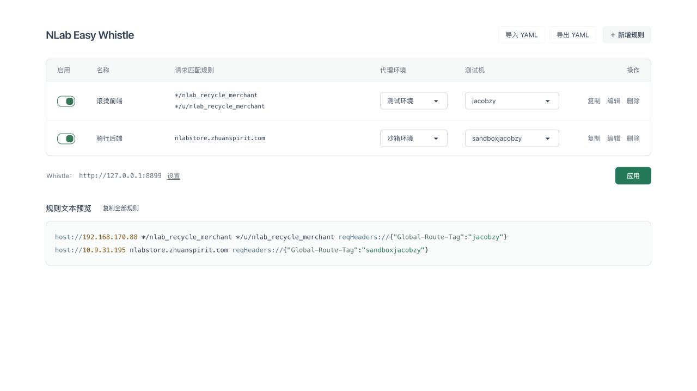

# NLab Easy Whistle

按已确认桌面原型实现的规则配置工具。使用 Vue 3.6 Vapor、Vite、TypeScript、Tailwind CSS 和 daisyUI。Tauri 2 桌面应用复用同一页面，交互、持久化、规则生成和 YAML 处理仍在 Web 中完成。

## 运行

需要 Node.js 22.12+ 和 pnpm。

```sh
pnpm install
pnpm dev
```

打开 <http://127.0.0.1:4317/>。

```sh
pnpm typecheck
pnpm test
pnpm build
pnpm preview
```

`dev` 和 `preview` 共用 4317 端口，运行其中一个即可。`dist/` 是独立静态 Web 产物。依赖锁定在 `pnpm-lock.yaml`；项目 `.npmrc` 使用官方 npm 源，不改全局配置。Vue 当前固定为 `3.6.0-rc.10`，全部 SFC 使用 `<script setup lang="ts" vapor>`，入口为 `createVaporApp`。

## 桌面运行与构建

需要 Rust 1.90+、Node.js 22.12+、pnpm，以及操作系统的 [Tauri 构建依赖](https://v2.tauri.app/start/prerequisites/)。macOS 需要 Xcode Command Line Tools，应用最低支持 macOS 13.3。

```sh
pnpm desktop:dev
pnpm desktop:test
pnpm desktop:build
```

`desktop:dev` 自动启动 4317 的 Vite 服务；先停止同端口的其他开发服务。`desktop:build` 先编译前端，再将 `dist/` 打入安装包。macOS 的应用位于 `src-tauri/target/release/bundle/macos/NLab Easy Whistle.app`，双击即可使用，无需 Node.js、Vite 或额外本地服务。只构建应用可运行 `pnpm desktop:build --bundles app`。

桌面端通过受限 Tauri command 在 Rust 中发送 HTTP 请求，兼容 Whistle.app 的本地凭据；这层替代 Web 模式的 Vite 转发，不复制规则生成或保存逻辑。没有引入通用 HTTP、文件系统、Shell 或凭据读取的前端权限。原生命令仅开放给主窗口，禁止远程页面权限，并启用 CSP。

桌面 YAML 导出使用系统保存对话框，取消不写文件。原生命令只接收 YAML 文本，写入路径由用户选择；先写临时文件，再原子替换目标，失败时保留已有文件。网页仍使用浏览器下载。导入和剪贴板沿用现有 Web API。

网页与桌面应用的本地配置各自保存。将现有网页配置导出为 YAML，再在桌面应用导入；不会自动共享浏览器数据。开发窗口与打包应用也不共享配置。

当前 macOS 构建用于本机运行，未配置发布签名、公证或自动更新。其他系统的编译依赖与安装包需在对应平台验证；Whistle.app 的 PID 鉴权仅支持 Unix，普通无鉴权 Whistle 实例不受此限制。

## 使用

- 表格逐行启用、切换测试/沙箱/本地环境；测试和沙箱选择测试机，本地输入端口（默认 8000，范围 1–65535），目标固定为 `127.0.0.1`。新增/编辑窗口也支持本地端口。
- 请求匹配规则前的“名称”列默认空白，可在新增/编辑窗口填写。名称仅用于识别规则，随本地配置和 YAML 保存，不参与 Whistle 匹配；旧配置缺少 `name` 时自动补为空字符串。
- 测试机下拉中的“新增测试机”保存名称并选中，其他行也能选择这台机器。
- 新增/编辑规则时，每行填写一项域名、URL、通配符或 Whistle 支持的正则。多个匹配项共享这一行的环境和测试机。
- 修改自动记忆到当前运行环境；网页与桌面配置各自独立。YAML 导入先校验并确认替换，导出包含连接地址、测试机列表和所有规则。
- “应用”才向 Whistle 写入；导入、切换和编辑不会自动写入。
- 操作列的“复制”只复制当前行的完整规则。页面下方使用代码块实时预览全部规则，操作符、IP 和请求头键值分色，关闭的规则以注释显示。标题旁的“复制全部规则”复制全部原文，也可以选中文本手动复制。

配置样例在 [design/nlab-easy-whistle.example.yaml](design/nlab-easy-whistle.example.yaml)。请求路径保留用户原文，包括 `*/sale`。路径匹配填写 `*/path`；不接受本地文件、Values、插件或其他 Whistle 操作符作为匹配项，避免它们被解释为同行操作。

本地环境不添加 `Global-Route-Tag`。例如匹配 `*/u/nlab-manage` 和 `*/nlab-manage`、端口填写 `8000` 时生成：

```text
host://127.0.0.1:8000 */u/nlab-manage */nlab-manage
```

本地规则在 YAML 中使用 `environment: local` 和数字 `port`；不要求填写 `machine`。端口随本地配置和 YAML 保存，切换环境后仍保留，再切回本地可继续使用。

## 连接 Whistle

页面底部“设置”修改 Whistle Web UI 地址，默认 `http://127.0.0.1:8899`。Web 模式使用浏览器 `fetch` 请求同源的 `/api/whistle/rules/*`，Vite 服务通过 HTTP 转发到 Whistle；`dev` 和 `preview` 都提供转发。桌面模式自动改用 Tauri 原生桥接，打包后不依赖 Vite。

转发仅支持本机地址，以及固定规则文件的读取、状态和保存接口；不提供任意 HTTP 代理。Whistle 桌面版还要求本地鉴权，服务端按官方进程文件核对目标主机、端口和活跃 PID 后携带认证头；凭据不进入浏览器、YAML、响应或日志，也不会发送到其他端口。无需修改 Whistle 的 CORS 配置。

两种模式均只允许无账号密码、查询参数或片段的本机 HTTP 地址：`127.0.0.1`、`localhost`、`[::1]`。不跟随重定向，保存表单上限 1 MiB，请求超时 10 秒；原生桥接不经过系统代理。

连接失败、认证失败和超时均显示错误，不报告成功。独立静态网页的自动应用仍需要同源转发服务；Tauri 安装包已包含桥接。

## 写入范围

规则固定写入 Whistle Rules 列表中的 `NLab Easy Whistle` 文件，不提供额外文件名配置。“应用”自动创建或更新该文件并启用它；已经关闭的同名文件也会重新启用。Whistle 单选模式下，勾选此文件会取消其他普通规则文件的选中状态；Default 的独立启停状态不受影响。

应用读取该文件及优先级设置，只替换以下保留标记包围的区域，其他规则保留原文：

```text
# BEGIN nlab-easy-whistle
host://192.168.170.88 */nlab_recycle_merchant */u/nlab_recycle_merchant reqHeaders://{"Global-Route-Tag":"jacobzy"}
# END nlab-easy-whistle
```

`host://IP` 与原先的环境 IP 操作含义一致，显式指定操作，防止全为 IP 的匹配项被 Whistle 反向解释。关闭的规则以 `#` 注释保存。删除全部规则后应用，只清理工具管理区。

可以在 Whistle 中手动取消该文件，或在管理区外添加自定义规则。下次“应用”会重新启用文件；管理区内的手工改动会按页面配置重新生成。

根据 `laterRulesFirst` 将管理区放在该文件首部或尾部。不自动开启全局规则；全局关闭时在保存后明确提示。跨文件优先级仍由 Whistle 的文件顺序和规则设置决定，因此“保存并回读确认”只表示内容保存成功，不能证明某个请求命中。

不读取、写入或迁移 `Default`。它的全部文本和启停状态保持原状，包括旧版本留下的管理区。

该文件中重复、残缺、乱序标记或出现在内嵌 Values 中的保留标记会在写入前停止操作。应用前再次读取内容和优先级，发现并发修改则停止；写入后逐字回读并核对文件已启用。Whistle 没有条件写入接口，两次读取与写入之间仍存在很小的并发窗口；不要同时在另一个窗口保存该文件。失败不自动回滚或重试。

## 验证

`vue-tsc` 和生产构建通过，141 项 Vitest 测试覆盖配置/YAML、名称往返与旧配置兼容、本地环境端口校验与记忆、输入边界、管理区保护、独立文件创建与自动启用、Default 访问保护、HTTP 契约、同源转发与鉴权边界、并发修改、回读失败、持久化错误、含端口地址高亮与原文保留、Tauri 调用与导出取消/失败。

7 项 Rust 测试覆盖固定接口/本机地址/保存表单边界、活跃 PID 鉴权、随机端口 HTTP 与重定向拒绝，以及 YAML 原子替换、失败保留和 UTF-8 大小上限。`cargo fmt --check` 通过。

macOS release 应用已构建并启动：在隔离 Whistle 2.10.9 实例验证创建/启用、取消后再次应用恢复启用、区外手写文本保留，以及 Default 文本和停用状态不变。实际系统保存窗口导出的 YAML 已逐字段核对并从桌面应用重新导入；保存取消、全部规则复制与退出重启后的配置记忆通过。桌面开发命令也已编译并启动。测试实例已停止，桌面连接地址恢复为 8899，本轮未写入真实 8899 实例。

正式构建在浏览器验证了逐行切换、刷新记忆、新增测试机、嵌套取消、规则新增/编辑/删除、YAML 导入/导出和非法文件保护。

代码块与表格复制功能在浏览器验证：不使用 textarea；高亮后的 DOM 文本、逐行复制和全部复制均与生成原文一致，空格及换行保留。

本次在浏览器验证实时预览、启停生成注释、一键复制与文本一致。未配置 CORS 的隔离 Whistle 实例验证了创建并启用、取消后再次应用恢复启用、区外手写文本保留，以及带旧管理区的 Default 全文和停用状态不变。真实桌面版 8899 的规则读取通过 dev 和 preview 同源转发返回 JSON；本次未写入真实实例。隔离实例已清理，页面连接地址恢复为 8899。



原型及 Figma 交付留在 `design/`。Web 与 Tauri 共用桌面布局，不包含移动布局。
